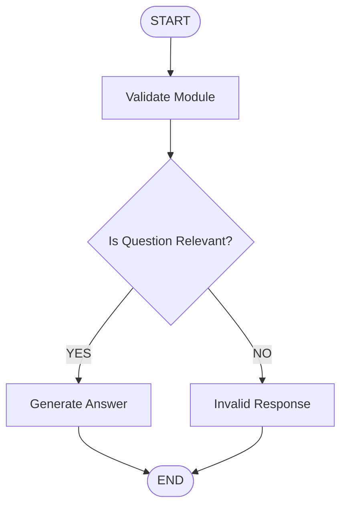

# 🤖 AI Study Guide – LangGraph

<p align="center">
  <b>Your Personalized AI Learning Assistant</b>
  <br>
  An intelligent, module-based study assistant powered by LangGraph, LangChain, Groq, and Streamlit.
</p>

---

## 📌 Project Overview

**AI Study Guide** is an AI-powered educational assistant designed to help students learn and understand different technical subjects through interactive conversations.

The application uses **LangGraph** to create a structured AI workflow that first validates whether a student's question is relevant to the selected learning module. If the question is relevant, the AI generates a structured explanation with practical examples. Otherwise, it politely restricts the response to the selected subject.

Powered by **OpenAI GPT-OSS 20B through Groq**, the application provides an interactive learning experience with conversation history, workflow visualization, and chat export functionality.

## ✨ Features

- 🤖 **AI-Powered Learning Assistant:** Get explanations and guidance using an LLM.
- 📚 **Eight Learning Modules:** Choose from different technical subjects.
- 🔍 **Question Validation:** Automatically checks whether questions are related to the selected module.
- 🔀 **LangGraph Workflow:** Uses conditional routing to control the AI response process.
- 💬 **Interactive Chat Interface:** Communicate with the AI through a conversational interface.
- 🧠 **Conversation Context:** Maintains recent conversation history to provide contextual responses.
- 📊 **Workflow Visualization:** View the LangGraph workflow directly within the application.
- 📥 **Download Conversation:** Export your complete conversation as a `.txt` file.
- ⭐ **User Feedback:** Provides a star-based feedback interface.
- ⚙️ **Module Management:** Change learning modules and clear previous conversations.
- 🔐 **Secure API Configuration:** Supports environment variables and Streamlit Cloud secrets.

## 📚 Available Learning Modules

The application currently supports eight learning modules:

| No. | Learning Module |
|---|---|
| 1 | Python |
| 2 | SQL |
| 3 | Power BI |
| 4 | Exploratory Data Analysis (EDA) |
| 5 | Machine Learning |
| 6 | Deep Learning |
| 7 | Generative AI |
| 8 | Agentic AI |

Each module has a dedicated AI assistant that focuses on answering questions related to the selected subject.

## 🛠️ Technologies Used

| Technology | Purpose |
|---|---|
| Python | Core programming language |
| Streamlit | Interactive web application interface |
| LangChain | Integration with Large Language Models |
| LangGraph | AI workflow orchestration and conditional routing |
| Groq API | LLM inference |
| OpenAI GPT-OSS 20B | Language model |
| Python-dotenv | Environment variable management |

## 🔄 LangGraph Workflow

One of the main components of this project is its graph-based AI workflow.

Instead of directly sending every question to the AI assistant, the application follows a validation-based process.

### Workflow Architecture



### Workflow Explanation

**1. Validate Module**

The user's question is sent to the LLM to determine whether it is related to the currently selected learning module.

**2. Conditional Routing**

LangGraph checks the validation result and decides which node should execute.

**3. Generate Answer**

If the question is relevant, the AI generates a structured response containing explanations, step-by-step guidance, and practical examples where appropriate.

**4. Invalid Response**

If the question is unrelated to the selected module, the application returns a predefined message asking the user to submit a relevant question.

**5. End**

Both execution paths terminate at the END node.

## 🧠 Conversation Management

The application uses Streamlit session state to manage conversations.

Key capabilities include:

- Stores user and AI messages during the session.
- Maintains recent conversation context for subsequent responses.
- Uses the latest 12 messages as context when generating an answer.
- Allows users to clear their conversation.
- Resets conversation history when switching learning modules.

## 📂 Project Structure

```text
AI-Study-Guide/
│
├── main.py              # Main Streamlit application
├── .env                 # Groq API key configuration
├── .gitignore           # Files excluded from Git
└── README.md            # Project documentation
```

## ⚙️ Installation and Setup

Follow these steps to run the project locally.

### 1. Clone the Repository

```bash
git clone <your-repository-url>
```

### 2. Navigate to the Project Directory

```bash
cd AI-Study-Guide
```

### 3. Install Required Dependencies

Make sure Python is installed on your system.

Install the required Python packages:

```bash
pip install streamlit python-dotenv langchain-groq langgraph
```

### 4. Configure Your Groq API Key

The application requires a Groq API key to communicate with the language model.

Create a `.env` file in the root project directory.

Add the following configuration:

```env
GROQ_API_KEY=your_groq_api_key
```

You can obtain your API key from:

🔗 https://console.groq.com/

**Important:** Never upload your actual API key or `.env` file to GitHub.

### 5. Run the Application

Execute the following command in your terminal:

```bash
streamlit run main.py
```

The application will start locally and open in your default web browser.

## ☁️ Streamlit Cloud Configuration

The application also supports Streamlit Cloud deployment.

To configure the API key:

1. Deploy your GitHub repository through Streamlit Community Cloud.
2. Open the application's Settings.
3. Navigate to the Secrets section.
4. Add the following configuration:

```toml
GROQ_API_KEY = "your_groq_api_key"
```

5. Save the configuration and run the application.

The application automatically checks Streamlit secrets if the API key is not found in the local `.env` file.

## 🖥️ Application Usage

1. Launch the application.
2. Select one of the eight available learning modules.
3. Enter your question in the chat input.
4. The LangGraph workflow validates your question.
5. If relevant, the AI generates an appropriate response.
6. Continue the conversation with contextual assistance.
7. View the LangGraph workflow using the expandable visualization section.
8. Download your conversation whenever needed.
9. Use the sidebar to change modules or clear the conversation.

## 🔐 Environment Variables

| Variable | Description |
|---|---|
| `GROQ_API_KEY` | API key required to access the Groq LLM service |

## 🚧 Future Improvements

Potential enhancements for future versions include:

- Add more technical and academic learning modules.
- Introduce learning progress tracking.
- Support personalized study plans.
- Add quiz and practice question generation.
- Implement conversation persistence across sessions.
- Improve the user interface and learning experience.

## 🎯 Project Objective

The primary objective of this project is to explore the practical implementation of Generative AI and Large Language Models in educational applications.

It also demonstrates how **LangGraph can be used to build structured AI workflows with conditional routing, state management, and controlled response generation.**

## 👨‍💻 Author

**Tanmoy Manna**

- GitHub: [Tanmoy-ctrl](https://github.com/Tanmoy-ctrl)

---

⭐ If you find this project interesting, consider giving the repository a star!

**Built with ❤️ using Python, LangGraph, LangChain, Groq, and Streamlit.**
